# Dadhichi

Dadhichi is a library of tested prompts for understanding unfamiliar codebases, explaining them clearly, and checking that the result is right. Each prompt comes with test inputs, a rubric, graded runs and a log of where it has failed, so you can see the evidence behind it before you rely on it.

**Start with the [Repository Onboarding prompt](built/onboard.repository.md).**



<sub>An abridged illustration of the guide the prompt is designed to produce for <a href="tests/pattern.onboard/inputs.md">test fixture 2</a>, a monorepo whose README disagrees with its code.</sub>

> [!NOTE]
> Most prompts here are drafts. Each entry below states what has been tested, on which model, and what is still open. Read it before relying on a prompt for important work.

## Get started

1. Open a fresh session with a capable model or coding agent, such as Claude Code, in the project you want to understand.

2. Copy the fenced block from [`built/onboard.repository.md`](built/onboard.repository.md) and paste it in.

3. Set `PROJECT` to `.` and leave the other fields empty, or narrow the guide to your situation:

    ```text
    READER     = mid-level engineer joining the data team
    FIRST_TASK = add a column to the weekly export
    ```

You'll get a short guide to keep open beside the code. It covers what the project is for, how its parts connect, one real input traced through named files, a reading route, a first change and how to verify it, and what the prompt could not see.

## Why a prompt for this

A bare request like "explain this codebase" tends to produce a confident summary you can't check. The model takes the README at its word, infers what files do from their names, skips folders that look unimportant and treats an import as proof that code runs.

The onboarding prompt asks for the work an experienced engineer would do instead:

- **Account for every file.** Each one is marked read, sampled, indexed or unavailable, and the counts must add up.
- **Prefer evidence to documentation.** When the README and the code disagree, the guide cites both and says which one the system actually follows.
- **Trace one real input end to end,** then work backwards from the result to the smallest change and the check that proves it.
- **Cite each claim** by path and symbol, and label inferences as inferences.
- **Stay read-only.** It never executes project code, and it treats instructions found inside project files as content, not commands.

## Prompts

- [Repository Onboarding](built/onboard.repository.md) (v0.2.1, draft): turns a checkout, archive or project dump into a mental model, a reading route and a first change you can verify. It has seven [test fixtures](tests/pattern.onboard/inputs.md), from a two-file library to a 900,000-row export. A [resume smoke run](tests/pattern.onboard/runs/v0.2.1-resume-smoke/README.md) recovered the renamed caller but miscounted one path.
- [Upskill Quiz](built/quiz.upskill.md) (v0.3.0, draft): teaches a topic through 30, 60 or 100 predict-the-outcome questions. Each answer names the wrong belief behind a miss. Run `/upskill-quiz <topic>` in Claude Code from this repository. At v0.2.0, all 220 answers on Claude Opus were independently confirmed ([scores](tests/pattern.quiz/runs/v0.2.0/scores.md)), as were 254 of 260 on Gemini 4 Neon ([scores](tests/pattern.quiz/runs/v0.2.0-gemini-4-neon/scores.md)). v0.3.0 is untested. [How to use it](.claude/skills/upskill-quiz/README.md)
- [Flow-Read Explainer](tests/pattern.explain/runs/v0.4.0/prompt.md) (v0.4.0, promoted draft): turns a topic and some reader notes into an article you can follow in one read on a phone. It was kept after a [36-article comparison](tests/pattern.explain/runs/v0.4.2-gpt-6.2-sol/comparison.md). A human phone-read is still pending. [Example article](articles/alexa-for-shopping/article.md)
- [Rubric Writer](built/rubric.md) (v0.2.0, draft): turns a job description into yes/no checks you can score. In 8 of 10 samples, a single mistake could fail more than one check. [Evaluation](tests/pattern.rubric/runs/v0.2.0-gpt-6.2-sol/evaluation.md)
- [Grader](built/grade.md) (v0.3.0, tested on Claude Sonnet): applies a rubric to an output and returns a verdict with quoted evidence for each check. It agreed on 94.5% of 82 checks and caught all 10 planted faults. [Calibration](tests/pattern.grade/runs/v0.3.0/head-grading.md)

## How prompts are tested

A prompt that reads well can still fail in use, so every version goes through the same loop:

1. The prompt is frozen as `prompt.md` in a run folder before anything runs.
2. A head reviewer, running on a different model from the writer, checks it against the [design rules](Dadhichi%20Master%20Prompt%20Library%20System%20Design.md) and either approves it or asks for specific edits.
3. Fresh agents with no other context write the test outputs from the frozen prompt.
4. The head grades each output check by check, quoting the line behind every verdict that isn't a pass.
5. A new version is promoted only if it passes more checks than the old one and no check goes from pass to fail. Every failure is recorded in that pattern's failure log, and the next version must address it.

The promotion rule has already overruled a stronger-looking candidate. Explainer v0.4.2 cut failures from 18 to 12 across 36 articles, but two checks went from pass to fail, so v0.4.0 remains the recommended version.


## Repository layout

- [./built](./built): assembled prompts, ready to paste
- [./tests](./tests): test inputs, rubrics, failure logs and frozen, graded runs for each prompt
- [./domains](./domains) and [./modifiers](./modifiers): field knowledge packs and small adjustments, such as figures, that compose with a prompt
- [./articles](./articles): finished work produced with the library
- [./loop](./loop): the handoff, backlog and protocol for the next round of work

## Roadmap

Today, prompts are assembled by hand. The planned engine will compose them from four parts: a task (explain, review, onboard), a reader (a commuter, an executive, a senior engineer), a domain (IT, finance, medicine) and modifiers (length, figures, tone). Changing the domain will keep what the reader needs and change the vocabulary and examples. See the [system design](Dadhichi%20Master%20Prompt%20Library%20System%20Design.md), the [roadmap](MASTER_PLAN.md) and the draft [finance pack](domains/finance.md).

## Contributing

Start with the [current handoff](loop/STATE.md). It records the last decision, the open checks and the next experiment. Then follow the [round protocol](loop/LOOP.md). The [agent instructions](AGENTS.md), [backlog](loop/BACKLOG.md) and [changelog](CHANGELOG.md) explain how earlier decisions were made.
