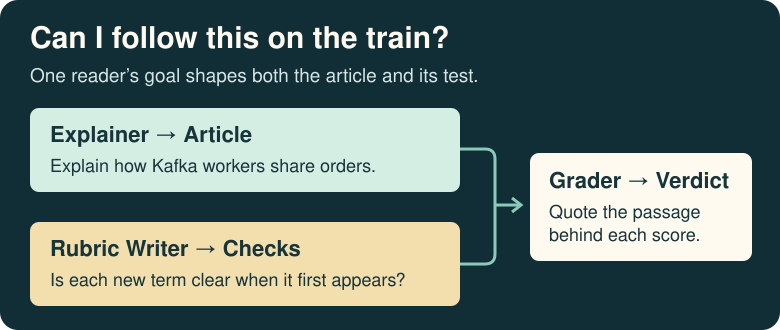

# Dadhichi

**Reusable prompts for writing explanations and checking whether they work.** Each prompt comes with examples, test inputs, and a record of where it succeeds or breaks. The goal is to let you choose a prompt for a particular reader and job, then see what evidence supports that choice.

[Try a prompt](#try-the-explainer) · [Read a finished article](articles/alexa-for-shopping/article.md) · [Resume development](loop/STATE.md)

## Try the Explainer

Imagine you know what a queue is. You want to understand what happens to an order when the worker processing it stops. You have ten minutes on a train and only your phone.

1. Copy the fenced prompt from the [Flow-Read Explainer v0.4.0](tests/pattern.explain/runs/v0.4.0/prompt.md).
2. Replace `{TOPIC}` with **How Kafka consumer groups share work**. Replace `{NOTES}` with **I know what a queue is. Walk me through what happens to one order when a worker stops.** Delete `{SOURCE}` and leave its tags empty, or paste in source material.
3. Paste the filled prompt into your model. Follow the order through the article. Can you tell what the next worker will read? Mark the first sentence where you need to scroll back or look up a term. That passage gives the next revision something concrete to fix.

For a source-backed example, see how the Alexa for Shopping article distinguishes Amazon’s published descriptions from a proposed architecture. [Read the article](articles/alexa-for-shopping/article.md) · [Inspect its sources](sources/alexa-for-shopping.md)

## Choose a prompt

| Prompt | When to use it | What the tests found |
| --- | --- | --- |
| [Flow-Read Explainer v0.4.0](tests/pattern.explain/runs/v0.4.0/prompt.md) | Turn a topic and reader notes into an article for one uninterrupted read. | **Promoted draft.** Kept after the nine-topic comparison below. A human phone-read is pending. |
| [Rubric Writer v0.2.0](built/rubric.md) | Turn a job description into checks you can score. | **Draft.** Review for double counting. In 8 of 10 samples, one mistake could fail multiple checks. [Evaluation](tests/pattern.rubric/runs/v0.2.0-gpt-6.2-sol/evaluation.md) |
| [Grader v0.3.0](built/grade.md) | Give it an output and a rubric to get a verdict and evidence for each check. | **Tested on Claude Sonnet.** Recorded 94.5% agreement across 82 checks and caught all 10 planted faults. [Calibration](tests/pattern.grade/runs/v0.3.0/head-grading.md) |

## Why the earlier Explainer won

We compared v0.4.0 and v0.4.2 on nine topics. Each version produced two articles per topic, for **36 articles**. The writer was `gpt-6.2-sol` and the grader was `gpt-6.2-astra`. For each topic and applicable check, the score below takes the worse of the two attempts.

The candidate cut failures from 18 to 12, but it also lost two passes outright. In the cloud article, readers encountered *requests* before learning what the word meant in computing. Another article used *Kafka consumer groups* before explaining the phrase. Both passages asked the reader to interpret an example with information that came later.

**v0.4.0 remains the version to use.** Promotion requires more passes and zero changes from pass to fail. The individual grades show which topics improved and where the grader’s interpretation was debatable. [Read the matched scorecard](tests/pattern.explain/runs/v0.4.2-gpt-6.2-sol/comparison.md)

## What we’re building toward

Today you copy an assembled Markdown prompt. The planned engine would let you specify the **task**, **reader**, and **domain** separately. For example, switching from Kafka to bond duration should preserve the commuter’s need for a linear explanation while drawing on finance-specific vocabulary and examples. A draft finance pack and frozen test prompt show how that combination works today. [Finance pack](domains/finance.md) · [Finance example](tests/pattern.explain/runs/v0.4.2-finance/prompt.md) · [Roadmap](MASTER_PLAN.md)

**Picking up the work?** Start at the [current handoff](loop/STATE.md). It records the last decision, outstanding checks, and the next experiment. The immediate task is to revise the Rubric Writer’s overlap check using the saved code-review and SQL failures. [Agent instructions](AGENTS.md) · [Backlog](loop/BACKLOG.md) · [Changelog](CHANGELOG.md)
