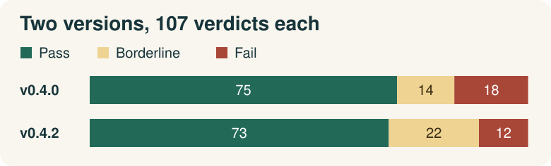

<div align="center">

# Dadhichi

**Prompts that read a codebase like an engineer, not a tourist.**

Tested, reusable prompts for understanding unfamiliar projects, explaining them and checking the result.<br>
Every prompt ships with test inputs, a rubric and a record of where it breaks.

[Quick start](#quick-start) · [Prompts](#prompts) · [How a prompt earns its place](#how-a-prompt-earns-its-place) · [Pick up the work](#pick-up-the-work)


<sub>The guide the onboarding prompt is designed to produce for <a href="tests/pattern.onboard/inputs.md">test fixture 2</a>, a monorepo whose README disagrees with its code. Abridged and illustrative.</sub>

</div>

## Why a prompt, for a codebase

Ask a model to *"explain this repo"* and it does what a hurried newcomer does. It takes the README at its word, guesses what `worker.py` does from the name, skips the folders that look boring and treats an `import` as proof that code runs. The summary sounds confident, and you can't check any of it.

```diff
- "Explain this codebase."
-   README says 20 items per invoice            → repeated as fact
-   worker.py                                   → "runs background jobs" (never opened)
-   migrations/, scripts/, .github/             → silently skipped
-   where do I make my first change?            → not answered

+ built/onboard.repository.md
+   README 20 vs packages/contracts/limit.js 12 → conflict cited, code wins
+   every file gets one status                  → read · sampled · indexed · unavailable
+   one real input traced end to end            → submit(13) → 'rejected'
+   first change                                → edit site, consumer, test, CI job
```

A prompt is a spec. It says what to inspect, what counts as evidence, what the reader gets and how you'd know if it lied. Dadhichi writes those specs and tests them like code.

## Highlights

- **Evidence over vibes** // Each claim cites a path and symbol. Inferences are marked as inferences.
- **Countable coverage** // Every file ends up read, sampled, indexed or unavailable, and the counts have to add up.
- **Read-only by design** // Project code is never executed. Instructions found in project files are treated as content, not commands.
- **Tested, not admired** // Fresh agents write the test outputs and a different model grades them. A new version is promoted only if no check goes from pass to fail.
- **Works anywhere** // Each prompt is plain Markdown. Paste it into any capable model or agent.

## Quick start

Onboard onto a project you have never seen:

```text
1. Open a fresh agent session (Claude Code, Codex, Cursor, …) in the project's folder.
2. Paste the fenced block from built/onboard.repository.md.
3. Set PROJECT to "." and leave the rest empty, or add a focus:
     READER     = "mid-level engineer joining the data team"
     FIRST_TASK = "add a column to the weekly export"
```

You get a guide you can keep open beside the code. It covers what the project is for, a small graph of how the parts connect, one input traced through named files, a reading route, your first change and how to verify it, and what it couldn't see.

**Learning something new?** In this repository, run `/upskill-quiz <topic> [low|medium|high]` in Claude Code. You'll get 30, 60 or 100 predict-the-outcome questions, the *"what gets logged, in what order?"* kind. Each answer names the wrong belief behind a miss. [How it works](.claude/skills/upskill-quiz/README.md)

## Prompts

| Prompt | Use it to | Evidence |
| --- | --- | --- |
| [**Repository Onboarding** v0.2.1](built/onboard.repository.md) | Turn a checkout, archive or project dump into a mental model, a reading route and a first change you can verify. | `draft` · 7 fixtures, from a two-file library to a 900,000-row export. A resume smoke run recovered the renamed caller, but it miscounted one path. [Fixtures](tests/pattern.onboard/inputs.md) · [Smoke run](tests/pattern.onboard/runs/v0.2.1-resume-smoke/README.md) |
| [**Upskill Quiz** v0.3.0](built/quiz.upskill.md) | Learn any topic through questions that make you predict an outcome, then repair the belief that got it wrong. | `draft` · At v0.2.0, all 220 answers on Claude Opus were independently confirmed, and 254 of 260 on Gemini 4 Neon. v0.3.0 is untested. [Opus scores](tests/pattern.quiz/runs/v0.2.0/scores.md) · [Neon scores](tests/pattern.quiz/runs/v0.2.0-gemini-4-neon/scores.md) |
| [**Flow-Read Explainer** v0.4.0](tests/pattern.explain/runs/v0.4.0/prompt.md) | Turn a topic and reader notes into an article you can follow in one read on a phone. | `promoted draft` · Kept after a 36-article comparison. A human phone-read is pending. [Scorecard](tests/pattern.explain/runs/v0.4.2-gpt-6.2-sol/comparison.md) |
| [**Rubric Writer** v0.2.0](built/rubric.md) | Turn a job description into yes/no checks you can score. | `draft` · In 8 of 10 samples, one mistake could fail more than one check. [Evaluation](tests/pattern.rubric/runs/v0.2.0-gpt-6.2-sol/evaluation.md) |
| [**Grader** v0.3.0](built/grade.md) | Apply a rubric to an output and get a verdict with quoted evidence for each check. | `tested` on Claude Sonnet · 94.5% agreement across 82 checks, and all 10 planted faults caught. [Calibration](tests/pattern.grade/runs/v0.3.0/head-grading.md) |

## How a prompt earns its place

```text
 write ──▶ gate review ──▶ test run ──▶ independent grade ──▶ promote?
   ▲        (head model)    (fresh agents,   (different model,       │
   │                         frozen prompt)   quotes every verdict)   │
   └─────────────── failure log ◀── any pass → fail ◀────────────────┘
```

A prompt is never trusted just because it reads well. Each version is frozen before it runs. Agents with no context write the test outputs, and a separate head model grades them check by check. A version is promoted only when it passes more checks and no check goes from pass to fail. Every failure goes into the pattern's failure log, and that log is what the next version has to fix.

This rule has already overruled a better-looking candidate. Explainer v0.4.2 cut failures from 18 to 12 across 36 articles, but two checks went from pass to fail, so v0.4.0 stayed.



## Where it's going

Prompts today are assembled by hand. The planned engine composes them from four parts: a **task** (explain, review, onboard), a **reader** (commuter, executive, senior engineer), a **domain** (IT, finance, medicine) and **modifiers** (length, figures, tone). Switching domains will keep the reader's needs and swap in that field's vocabulary. [System design](Dadhichi%20Master%20Prompt%20Library%20System%20Design.md) · [Roadmap](MASTER_PLAN.md) · [Finance pack](domains/finance.md)

```text
built/        assembled prompts, ready to paste
tests/        inputs, rubrics, failure logs and frozen runs for each pattern
domains/      field knowledge packs        modifiers/   small dials (figures, length)
loop/         handoff, backlog and protocol for the next round of work
articles/     finished output, e.g. Alexa for Shopping
```

## Pick up the work

Start at the [current handoff](loop/STATE.md). It records the last decision, the open checks and the exact next experiment. Then follow the [round protocol](loop/LOOP.md). · [Agent instructions](AGENTS.md) · [Backlog](loop/BACKLOG.md) · [Changelog](CHANGELOG.md)
