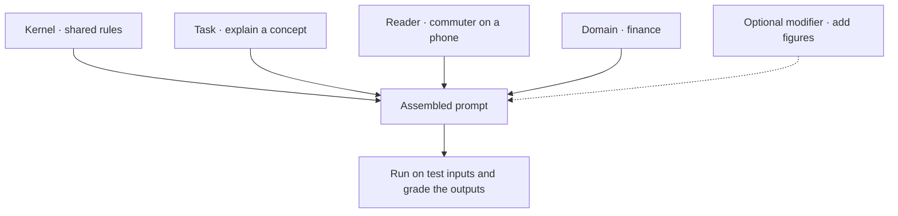

# Dadhichi

**A library of reusable prompts with a record of how well each one works.**

Suppose you ask for an explanation of Kafka consumer groups to read on the train. Halfway down the first screen, you meet the word *partition*. The definition comes three paragraphs later. The explanation may be technically accurate, but you have already had to stop reading. For a commuter with no browser open, that is a failure we can test for.

Dadhichi starts with moments like that. We describe the job, the person who needs the result, and what a good answer lets them do. Then we turn those expectations into checks, run the prompt on difficult inputs, and keep the outputs that tell us where it breaks. **Our goal is to let someone choose a prompt for a real job, see the evidence behind it, and adapt it to a different reader or field.**

[Try the explainer](#try-the-explainer) · [Explore the library](#the-library-today) · [Follow a version decision](#why-v040-is-still-the-explainer-to-try) · [See where this is going](#where-this-is-going)

> **Picking up development?** Read the [current handoff](loop/STATE.md) for the last result and the next task. [Agent instructions](AGENTS.md)

## Try the explainer

The **Flow-Read Explainer** writes an article you can read once, top to bottom, on a phone or e-reader. It introduces terms as you need them and carries a worked example through the explanation. You can try it by pasting Markdown into a model.

1. Open the [promoted v0.4.0 explainer](tests/pattern.explain/runs/v0.4.0/prompt.md) and copy the prompt inside the fenced block.
2. Replace the three placeholders using the example below. For an empty source, remove the placeholder and keep the surrounding tags.
3. Paste the filled prompt into your model. As you read the article, notice the first place you need to scroll back, look something up, or guess what a term means. That moment makes a good test case.

| Placeholder | Example |
| --- | --- |
| `{TOPIC}` | How Kafka consumer groups share work |
| `{NOTES}` | I know what a queue is. I want to understand what happens when one consumer stops halfway through a batch. |
| `{SOURCE}` | Leave empty for this example, or paste documentation you want the article to follow. |

For a source-backed example, read the Alexa for Shopping article alongside its source pack. The pack distinguishes Amazon's product descriptions, published research, and an independently guessed architecture. The article has to preserve those distinctions even when it brings the pieces together in a single explanation. [Finished article](articles/alexa-for-shopping/article.md) · [Source pack](sources/alexa-for-shopping.md) · [Original grading](tests/pattern.explain/runs/v0.2.1-alexa/head-grading.md)

## The library today

As of **18 November 2026**, three prompts are available. A **promoted draft** is the version selected through comparison with its predecessor. The **tested** label records that a prompt met its acceptance criteria on a named model and test set.

| Prompt | What you give it → what you get | Evidence |
| --- | --- | --- |
| [Flow-Read Explainer v0.4.0](tests/pattern.explain/runs/v0.4.0/prompt.md) · promoted draft | A topic, optional source and reader notes → an article for a single linear read | Nine topics cover short definitions, complex mechanisms, a fictional tool, finance and mixed-confidence sources. [Version comparison](tests/pattern.explain/runs/v0.4.2-gpt-6.2-sol/comparison.md) |
| [Grader v0.3.0](built/grade.md) · tested | An output and a rubric → a verdict for each check, backed by a quote, count or named omission | On Claude Sonnet, it reached 94.5% agreement across 82 checks and found all 10 deliberately planted faults. [Calibration report](tests/pattern.grade/runs/v0.3.0/head-grading.md) |
| [Rubric Writer v0.2.0](built/rubric.md) · draft | A job, optionally its reader, prompt and past failures → a table of checks and rules for scoring them | In eight of ten samples, one mistake could fail two checks. A missing consequence in a code review, for instance, could be counted twice. [Evaluation](tests/pattern.rubric/runs/v0.2.0-gpt-6.2-sol/evaluation.md) |

The three prompts can work together. A writer defines what an explanation should achieve, uses the Rubric Writer to draft the checks, and inspects them for overlap. After generating an article, they give it and the rubric to a different model running the Grader. The saved evidence lets another person challenge a verdict or reproduce the comparison.

## Why v0.4.0 is still the explainer to try

The v0.4.2 candidate produced fewer outright failures. Was it better for the reader? We ran both versions on the same nine inputs, twice per input, for **36 articles**. Every article had the same writer model (`gpt-6.2-sol`) and a separate grader model (`gpt-6.2-astra`). Each input contributed the worse of its two verdicts on each applicable check.

| Version | Pass | Borderline | Fail |
| --- | ---: | ---: | ---: |
| v0.4.0 | **75** | 14 | 18 |
| v0.4.2 | 73 | 22 | **12** |

The project promotes a revision when it passes more checks and no previously passing check becomes a failure. Here, two checks moved from Pass to Fail. One cloud article used *requests* before explaining the computing meaning. One library article asked the reader to interpret *Kafka consumer groups* before explaining the phrase. **v0.4.0 remains the promoted draft.** The scorecard includes the individual grades, where the judge's interpretation was debatable, and the outstanding human phone-read. [Matched scorecard](tests/pattern.explain/runs/v0.4.2-gpt-6.2-sol/comparison.md) · [Current candidate](built/explain.commuter.it.md) · [Failure log](tests/pattern.explain/failures.md) · [Phone-read status](loop/STATE.md)

## Where this is going

The long-term design is a prompt engine that can take a request such as *“Explain bond duration to someone reading on the bus”* and assemble a brief from reusable parts.

The task determines the work. The reader determines how much background, time and attention the answer can assume. The domain supplies field knowledge. In the bond-duration test, for example, the commuter still needs a linear explanation, but the relevant vocabulary shifts from servers and requests to prices and interest rates. The repository already has a draft finance pack, frozen finance test prompts and an optional figures modifier. General-purpose assembly is a roadmap milestone. [Finance pack](domains/finance.md) · [Finance test prompt](tests/pattern.explain/runs/v0.4.2-finance/prompt.md) · [Figures modifier](modifiers/figures.md)

The next milestones are to finish the explainer, demonstrate that readers and domains can be swapped independently, and strengthen the tools that generate and grade tests. The planned library then expands into developer work such as code review and diagnosis, agent instructions and handoffs, and checks for handling untrusted or uncertain source material. Each addition needs its own test inputs and acceptance criteria. [Master plan](MASTER_PLAN.md) · [System design](Dadhichi%20Master%20Prompt%20Library%20System%20Design.md)

## Explore or contribute

| If you want to… | Start here |
| --- | --- |
| Use the prompts or inspect real examples | [Assembled prompts](built/) · [Articles](articles/) |
| Understand why a prompt changed | [Test suites and frozen runs](tests/) · [Changelog](CHANGELOG.md) |
| Pick up development | [Current handoff](loop/STATE.md) · [Backlog](loop/BACKLOG.md) |
| Understand how an unattended round works | [Round protocol](loop/LOOP.md) · [Runner](scripts/) · [Reviewer brief](.claude/agents/dadhichi-head.md) |

The most useful contribution today is a reproducible failure. Open an issue with the prompt version, model, input, and the shortest passage that shows what went wrong. Say what the reader needed at that point. That gives the next revision a concrete case to beat.

Formal contribution guidelines and the project licence are still open items in the [master plan](MASTER_PLAN.md).
