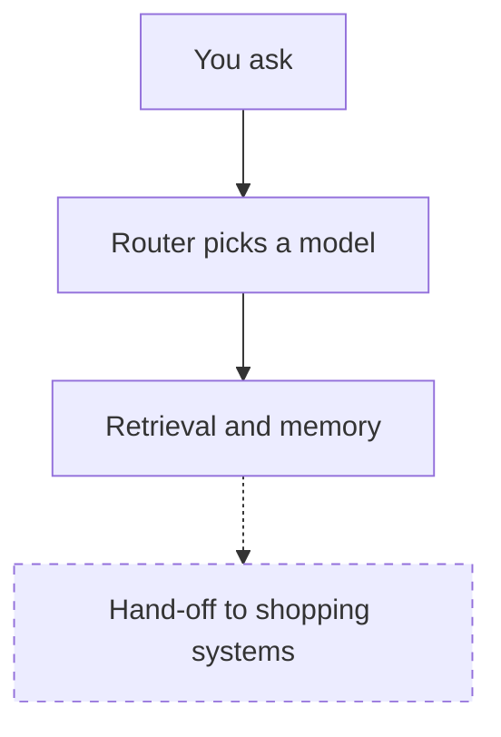

# Figures modifier

Paste the block below into an explainer prompt, directly after its `<write>` section. It replaces that prompt's "there will be no diagrams" rule. Charts come out as Mermaid code, which renders on GitHub, Notion, Obsidian and most Markdown editors. For a Kindle, convert each one to an image first (for example with mermaid-cli: `mmdc -i in.mmd -o out.png`).

```markdown
<figures>
You may include up to three figures, drawn as Mermaid flowcharts. Add one only where the reader has to hold a sequence, a structure, or a comparison in their head, because that is where a picture saves effort. A simple piece usually needs none, and never more than one.

The prose stays complete without the figures. Some readers will see them as images, some as broken code, and some not at all, so a figure repeats what the text has already explained; it never carries a fact the text leaves out. Place each figure straight after the passage that explains what it shows, never before it.

Keep every figure small enough to read on a phone held in one hand: a top-to-bottom chart (flowchart TD), at most eight boxes, and labels of six words or fewer. Use the same names in the boxes as in the prose, because a renamed step makes the reader wonder whether it is a new one.

When the piece separates confirmed facts from inference or guesses, show the difference: draw inferred or guessed steps with dashed arrows (-.->) and give their boxes a dashed outline (style X stroke-dasharray: 5 5), and say in the caption what the dashes mean.

Give each figure a caption on the line below it, written as one full sentence that states what the figure shows, so it still says something when the image fails to load.

Format:

*Figure 1. One request from question to purchase; the dashed step is inferred, not published.*
</figures>
```

Checks to add to the rubric when this modifier is used:
- Figures earn their place: each shows a sequence, structure, or comparison, and a simple topic has at most one.
- Prose stands alone: deleting every figure leaves no gap in the explanation.
- Readable on a phone: top-to-bottom, at most eight boxes, labels of six words or fewer.
- Captions are full sentences, and dashes are used for anything inferred or guessed.
